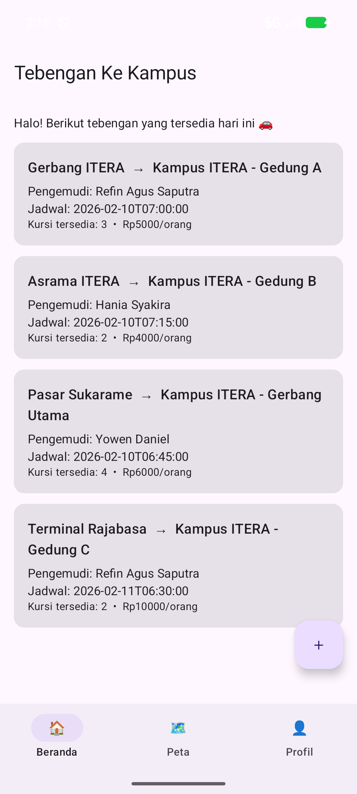
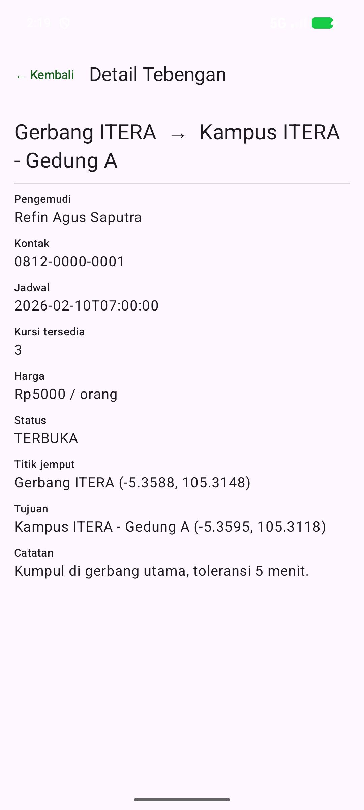
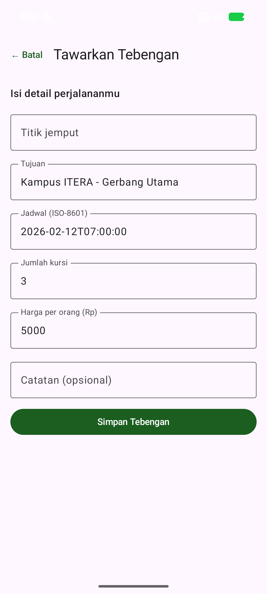
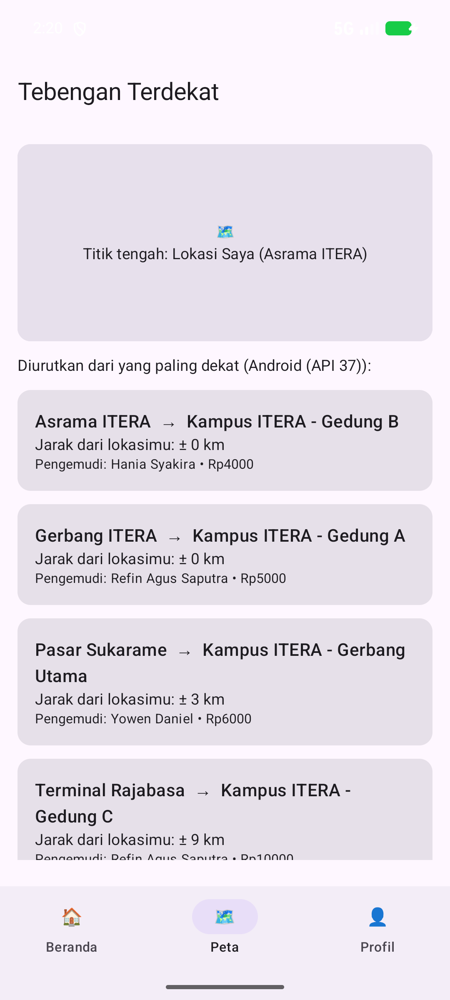
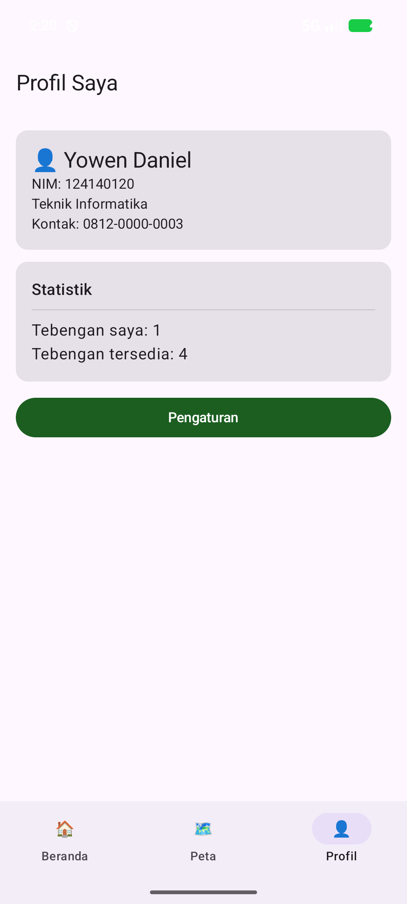
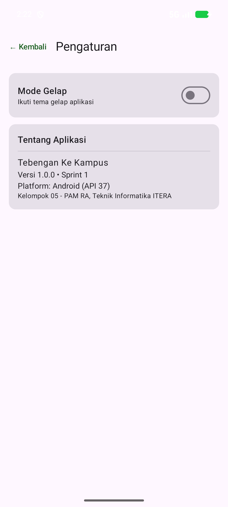
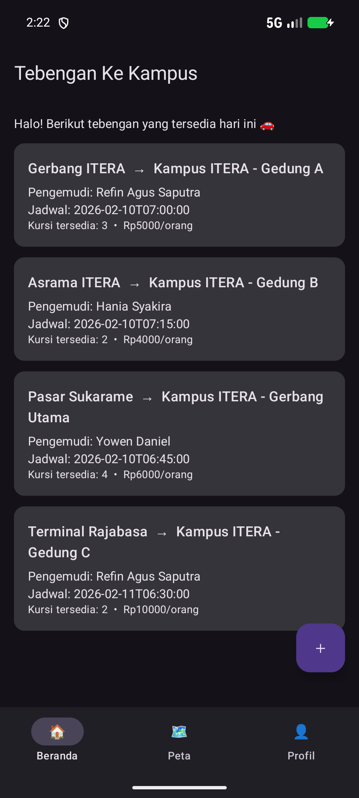

# Tebengan Ke Kampus

[](https://github.com/HaniaSyakira-jpg/Kel05-TebenganKeKampus/actions/workflows/ci.yml)

Aplikasi mobile multiplatform untuk mencari dan menawarkan tumpangan (tebengan) menuju kampus ITERA. Dibuat dengan Kotlin Multiplatform + Compose Multiplatform untuk tugas akhir mata kuliah IF25-22017 Pengembangan Aplikasi Mobile.

Latar belakangnya sederhana. Banyak mahasiswa berangkat ke kampus dengan kursi kosong, sementara yang lain kesulitan cari tumpangan. Aplikasi ini mempertemukan keduanya, lalu mengurutkan tawaran berdasarkan jarak titik jemput ke posisi pencari. Bagian terakhir itu yang jadi fokus tema kelompok kami: **Lokasi**.

## Tim — Kelompok 05 PAM RA

| Nama | NIM | Peran | GitHub |
|---|---|---|---|
| Refin Agus Saputra | 124140126 | Ketua, integrasi antar fitur, QA | [@Avnzgs864](https://github.com/Avnzgs864) |
| Hania Syakira | 124140114 | UI/UX dan implementasi layar | [@HaniaSyakira-jpg](https://github.com/HaniaSyakira-jpg) |
| Yowen Daniel | 124140120 | Arsitektur, data layer, CI/CD, testing | [@wennn99](https://github.com/wennn99) |

## Status pengerjaan

Sprint 1 (minggu ke-11) sudah selesai. Yang saat ini sudah jalan:

- Struktur proyek KMP dengan pemisahan layer presentation / domain / data
- 6 layar Compose: Beranda, Detail, Tambah, Peta, Profil, Pengaturan
- Navigasi antar layar + bottom navigation, termasuk passing data lewat route `detail/{id}`
- State management pakai `StateFlow` dan sealed interface untuk UI state
- Dependency injection pakai Koin
- 10 unit test (4 file) untuk perhitungan jarak, use case, repository, dan mapper
- CI GitHub Actions: build + test otomatis tiap push/PR

Yang belum selesai, sesuai rencana sprint berikutnya:

- **Ktor belum dipakai.** Dependency-nya sudah dimasukkan ke build config sejak Sprint 1, tapi belum ada kode yang memanggilnya. Kami sengaja menaruhnya sekarang supaya Sprint 3 tidak perlu ubah konfigurasi build lagi — risikonya, ada dependency yang menganggur selama dua sprint.
- **Data masih disimpan di memori.** Kalau aplikasi ditutup, tebengan yang baru ditambahkan akan hilang. Ini bukan bug, tapi memang belum dikerjakan; penyimpanan permanen (SQLDelight) masuk Sprint 3.
- **Peta belum pakai GPS.** Koordinat lokasi pengguna masih di-hardcode di `PetaViewModel`, dan penanda peta masih berupa kotak placeholder, belum peta sungguhan.
- **Baru 10 unit test, belum ada UI test.** Syarat minimal 10 unit test + 3 UI test baru terpenuhi separuh. UI test menyusul di Sprint 4.

## Screenshot

Diambil dari Android Emulator (Pixel 7, API 37).

<table>
  <tr>
    <td align="center"><br><sub>Beranda — daftar tawaran tebengan</sub></td>
    <td align="center"><br><sub>Detail Tebengan</sub></td>
    <td align="center"><br><sub>Tawarkan Tebengan</sub></td>
  </tr>
  <tr>
    <td align="center"><br><sub>Tebengan terdekat — fitur tema Lokasi</sub></td>
    <td align="center"><br><sub>Profil</sub></td>
    <td align="center"><br><sub>Pengaturan</sub></td>
  </tr>
</table>

<p align="center">
  
  <br><sub>Mode gelap</sub>
</p>

## Fitur

**Wajib**

- [x] Beranda: daftar tawaran tebengan dalam `LazyColumn`
- [x] Detail tebengan: rute, jadwal, kursi tersisa, ongkos, kontak pengemudi
- [x] Tambah tebengan: form tawaran baru
- [x] Peta: daftar tebengan terurut berdasarkan jarak
- [x] Profil pengguna dan statistik sederhana
- [x] Pengaturan: toggle mode gelap dan info aplikasi
- [x] Navigasi multi-layar dengan argument passing
- [x] MVVM + clean architecture
- [x] State management dengan `StateFlow`
- [x] Dependency injection dengan Koin
- [ ] REST API (Ktor) — Sprint 3
- [ ] Database lokal untuk CRUD permanen — Sprint 3
- [ ] Minimal 10 unit test + 3 UI test — separuh, Sprint 4

**Bonus**

- [x] CI/CD otomatis (+5%)
- [x] Mode gelap (+5%)
- [x] Target iOS: `iosX64`, `iosArm64`, `iosSimulatorArm64` (+10%)
- [ ] Offline-first (+5%)
- [ ] Signed APK/AAB (+5%)
- [ ] Integrasi AI (+10%, opsional)

Target yang dipakai: Android (minSdk 24, compile/target SDK 36) dan iOS. Kami menambahkan target desktop JVM bukan karena diminta, tapi supaya unit test bisa dijalankan di CI Linux tanpa perlu emulator atau macOS.

## Teknologi

| Bagian | Yang dipakai |
|---|---|
| Bahasa & framework | Kotlin 2.2.20, Compose Multiplatform 1.9.0 |
| Build | Gradle 8.14.3 (Kotlin DSL + version catalog), AGP 8.11.2 |
| Arsitektur | MVVM, clean architecture, repository pattern |
| Async & state | Coroutines 1.10.2, Flow, StateFlow |
| DI | Koin 4.1.1 |
| Navigasi | JetBrains Navigation Compose 2.9.2 |
| Networking | Ktor 3.2.3 + Kotlinx Serialization 1.9.0 (belum dipakai) |
| Testing | kotlin-test, kotlinx-coroutines-test |
| CI | GitHub Actions |

## Arsitektur

Ada tiga layer, dan arah dependensinya selalu ke dalam: `presentation` → `domain` ← `data`.

- **domain** — model (`Tebengan`, `TitikLokasi`), interface `TebenganRepository`, dan use case. Tidak Tahu apa pun soal UI atau sumber data, jadi bisa diuji tanpa Android sama sekali.
- **data** — implementasi repository, sumber data lokal, DTO + mapper. Saat ini repository hanya membungkus penyimpanan in-memory.
- **presentation** — ViewModel dan composable. ViewModel hanya mengeluarkan `StateFlow`, tidak menyentuh Compose.

Struktur folder dan alasan tiap keputusan teknis ada di [docs/ARCHITECTURE.md](docs/ARCHITECTURE.md).

## Menjalankan proyek

Butuh JDK 17, Android SDK Platform 36, dan Android Studio. Kalau mau menjalankan target iOS, harus di macOS dengan Xcode.

```bash
git clone https://github.com/HaniaSyakira-jpg/Kel05-TebenganKeKampus.git
cd Kel05-TebenganKeKampus

./gradlew :composeApp:installDebug        # jalankan di emulator/device
./gradlew :composeApp:run                 # versi desktop, buat cek cepat tanpa emulator
./gradlew :composeApp:desktopTest :composeApp:testDebugUnitTest   # unit test
./gradlew :composeApp:assembleDebug       # build APK debug
```

File `local.properties` yang berisi path Android SDK tidak ikut di-commit; Android Studio akan membuatnya sendiri saat sync.

## CI

`.github/workflows/ci.yml` jalan tiap push dan pull request ke `main` atau `develop`. Isinya:

1. Checkout dan setup JDK 17
2. Pasang paket Android SDK yang dibutuhkan (`platforms;android-36`, `build-tools;35.0.0`)
3. Jalankan `:composeApp:testDebugUnitTest` dan `:composeApp:desktopTest`
4. Build `:composeApp:assembleDebug`
5. Upload laporan test sebagai artifact

Langkah tesnya sengaja tidak memakai task `test` biasa karena itu akan ikut menjalankan task iOS, yang tidak mungkin jalan di runner Linux.

## Alur kerja git

`main` ← `develop` ← `feature/*`. Tidak ada yang push langsung ke `main`.

```bash
git checkout develop
git checkout -b feature/nama-fitur
# kerjakan
git commit -m "feat: tambah layar filter"
git push origin feature/nama-fitur
# buka pull request, minta review, baru merge
```

Format commit: `feat:`, `fix:`, `refactor:`, `test:`, `docs:`, `style:`, `chore:`.

## Rencana sprint

| Sprint | Minggu | Isi |
|---|---|---|
| 1 | 11 | Planning, arsitektur, repo, CI/CD — selesai |
| 2 | 12 | Layar utama, navigasi, data layer, CRUD |
| 3 | 13 | Ktor, SQLDelight, permission lokasi |
| 4 | 14 | Polish UI, unit test + UI test |
| 5 | 15 | Perbaikan akhir, persiapan demo |

Rincian fitur per sprint dan pembagian tugas tiap anggota ada di [docs/PROJECT_PLAN.md](docs/PROJECT_PLAN.md).

## Dokumentasi lain

- [docs/PROJECT_PLAN.md](docs/PROJECT_PLAN.md) — kebutuhan, rencana sprint, pembagian tugas
- [docs/ARCHITECTURE.md](docs/ARCHITECTURE.md) — penjelasan arsitektur dan keputusan teknis

---

Proyek akademik untuk IF25-22017 Pengembangan Aplikasi Mobile, Teknik Informatika, Institut Teknologi Sumatera.
